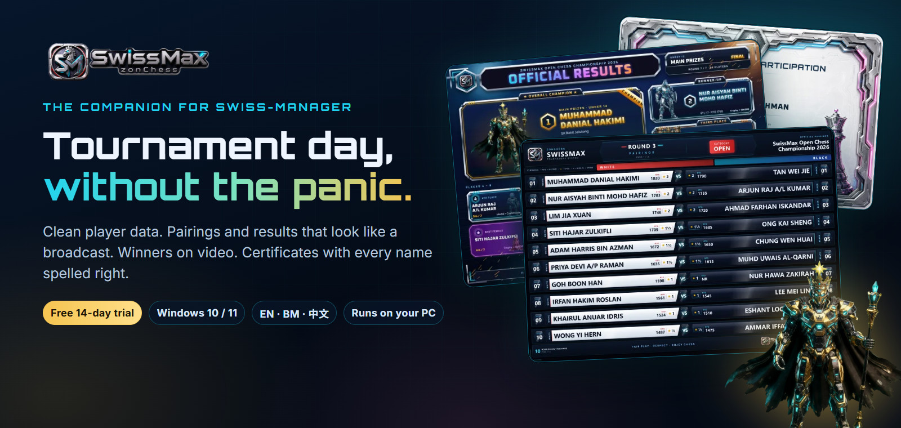
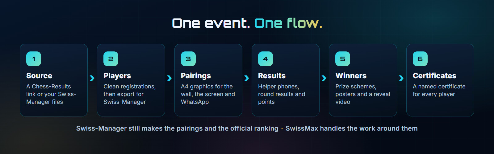
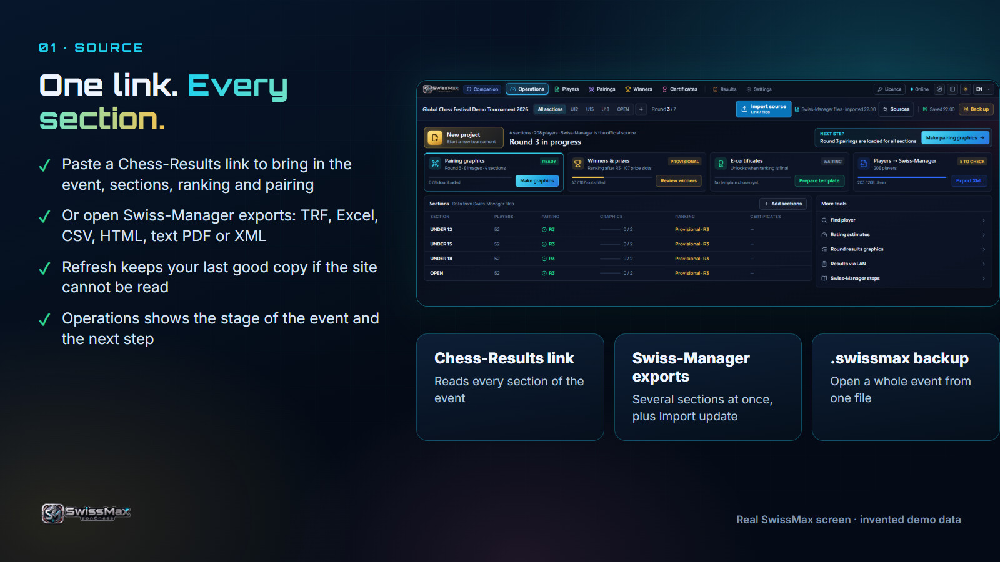
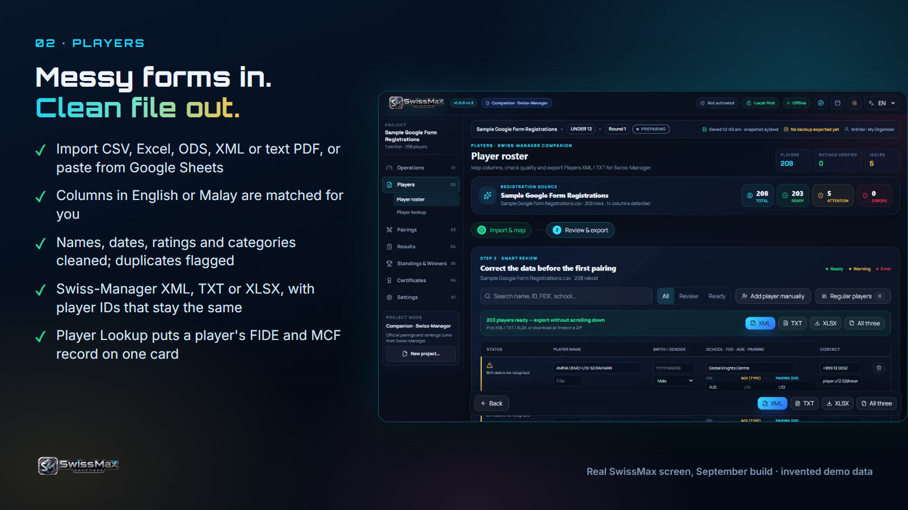
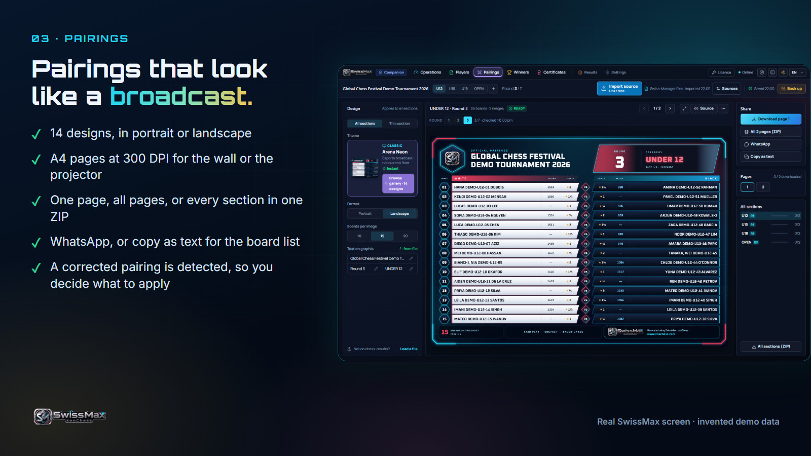
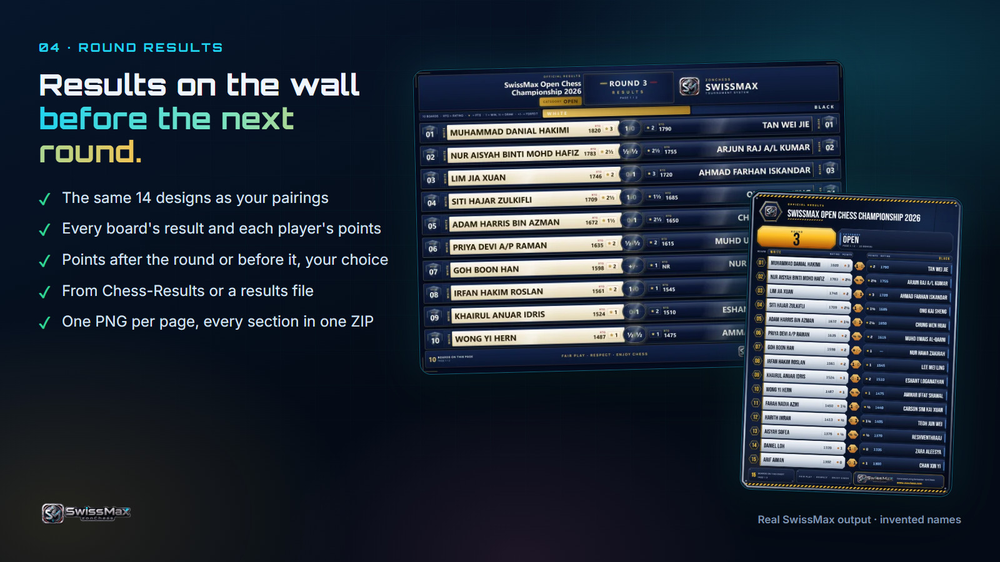
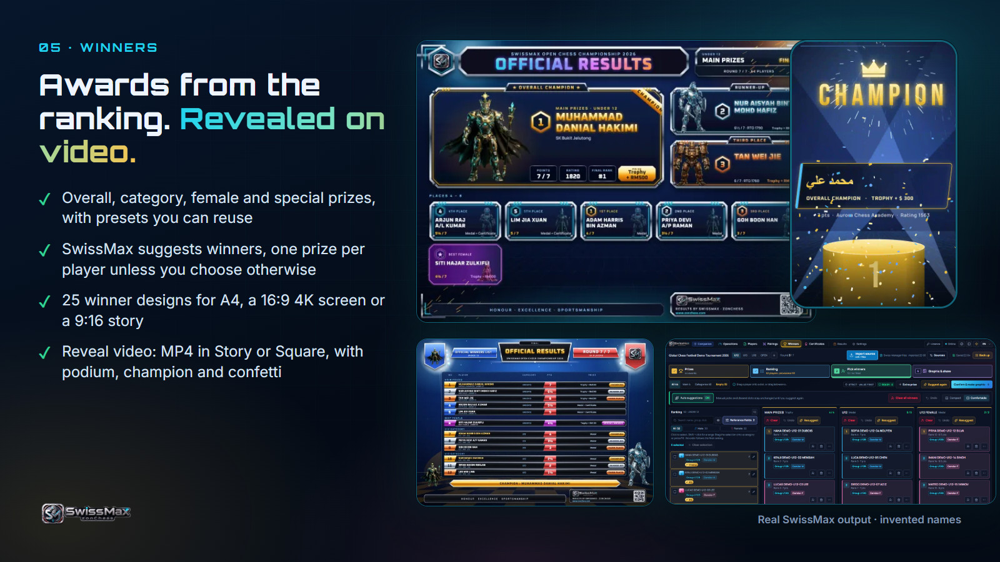
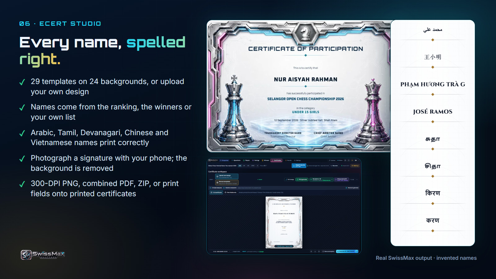
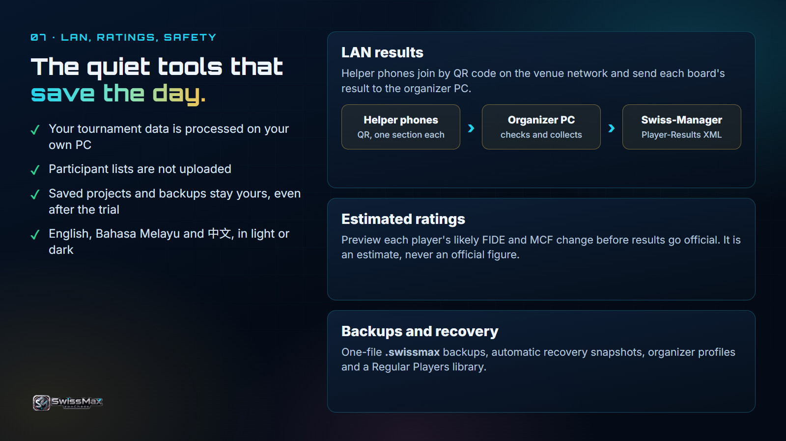
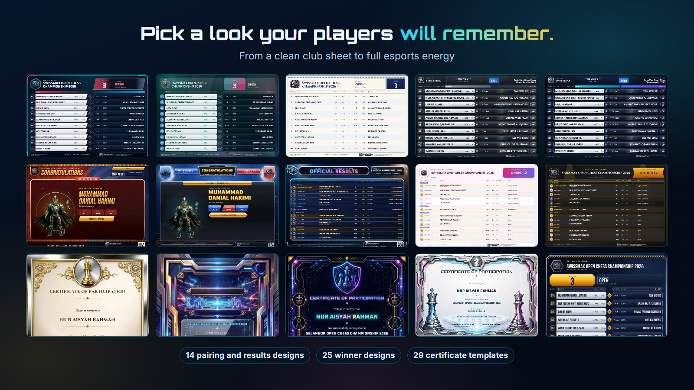

<p align="center">
  
</p>

<h3 align="center">A Windows companion for chess organizers who use Swiss-Manager</h3>

<p align="center">
  <a href="https://github.com/mfamirs/swissmax-downloads/releases/tag/companion-v1.0.0-rc.20"><b>⬇ Download the free 14-day trial</b></a>
  &nbsp;·&nbsp;
  <a href="#what-swissmax-does">See what it does</a>
  &nbsp;·&nbsp;
  <a href="#install-and-first-run">Install</a>
  &nbsp;·&nbsp;
  <a href="https://zonchess.com/contact.html">Send feedback</a>
</p>

## What is SwissMax?

**SwissMax Companion is a Windows app for chess tournament organizers and arbiters who use Swiss-Manager.** It helps with the work around a tournament: cleaning player data, publishing pairings and results, working out prizes, revealing winners and printing certificates. **Swiss-Manager still makes the pairings and the official ranking, and the arbiter keeps authority over them.** SwissMax handles everything around that.

It was built in Malaysia by an independent chess parent, shaped by real tournaments and by experienced organizers and arbiters.

## The trial at a glance

| | |
|---|---|
| **Price** | Free for 14 days, with no key or payment details |
| **Features** | Every Companion feature is open during the trial |
| **Start** | The 14 days begin only when you choose to start them. Internet is needed for that moment only |
| **System** | Windows 10 or 11, 64-bit |
| **Languages** | English, Bahasa Melayu and 中文 |
| **Your data** | Tournament data is processed on your own PC. Participant lists are not uploaded |

<p align="center">
  
</p>

## Problems it solves

| On tournament day | How SwissMax helps |
|---|---|
| Registrations arrive as a messy Google Form or Excel sheet | Cleans them and exports Swiss-Manager XML, TXT or XLSX |
| Pairing lists are hard to read on the wall or in WhatsApp | Turns a Chess-Results link or Swiss-Manager files into A4 graphics |
| Many sections mean many screenshots | One link brings in every section, and one ZIP holds every page |
| Players keep asking for the latest results and points | Round results graphics show every board, with each player's points added up |
| Prizes are checked by hand late in the day | Prize schemes suggest winners from the official ranking |
| Certificates take hours, and names get misspelled | A named certificate for every player in one batch, in many scripts |
| Helpers carry result slips across the hall | Helper phones send results to the organizer PC over the venue network |

## What SwissMax does

- [Source and operations](#1-source-and-operations)
- [Players and Swiss-Manager files](#2-players-and-swiss-manager-files)
- [Pairing graphics](#3-pairing-graphics)
- [Round results](#4-round-results)
- [Winners and reveal video](#5-winners-and-reveal-video)
- [eCert Studio](#6-ecert-studio)
- [LAN results, ratings and safety](#7-lan-results-ratings-and-safety)
- [Settings and support](#8-settings-and-support)

### 1. Source and operations



- **Chess-Results link:** paste one link and SwissMax reads the event, creates each section, and loads the ranking and the pairing of the round you choose.
- **Swiss-Manager exports:** TRF, or pairing and ranking lists as Excel, CSV, HTML, text PDF or XML. Several sections can be opened at once, and Import update takes a newer file.
- **Refresh with a safety net:** the last good pairing and ranking stay if the site cannot be read.
- **Operations overview:** see what stage each section is at and the next sensible step, with tournament, section and round always in view.

Swiss-Manager's own `.TUNX` and `.TURX` tournament files are not read.

### 2. Players and Swiss-Manager files



- **Import what the form produced:** CSV, Excel, ODS, XML or text-layer PDF, or paste straight from Google Sheets.
- **Smart mapping:** columns in English or Malay are matched for you, and mapping profiles can be saved.
- **Review before the first pairing:** names, dates of birth, gender, ratings and categories are cleaned, and duplicates are flagged.
- **International players:** federation, FIDE ID and national ID or passport are carried through.
- **Export:** Swiss-Manager XML, TXT or XLSX, or all of them in a ZIP. Each player keeps the same XML player ID when you export again.
- **Player Lookup:** one card for a player's FIDE and MCF record. MCF is Malaysia's national rating list. If you would like your own federation handled the same way, please [tell us](https://zonchess.com/contact.html).

### 3. Pairing graphics



- **14 designs:** six classic, seven premium and a printer-friendly sheet, in portrait or landscape.
- **A4 pages at 300 DPI** for the wall, the projector or the parents' group.
- **Share your way:** one page, all pages, every section in one ZIP, WhatsApp, or Copy as text.
- **Corrections:** when a round is republished, SwissMax shows what changed. You choose to apply it or keep the old pairing.

### 4. Round results



- **The same 14 designs** as your pairings, with every board's result.
- **Points added up** for each player, after the round or before it.
- **Results from Chess-Results** or a results file (Excel, CSV or HTML).
- **One PNG per page,** every section in one ZIP, WhatsApp or Copy as text.

### 5. Winners and reveal video



- **Prize schemes:** overall, category, female and special prizes, with presets you can save, share and copy to other sections.
- **From the official ranking:** load the final ranking from Chess-Results or a file, and SwissMax suggests winners. One prize per player unless you choose otherwise.
- **Ranking rail:** keep it beside you or float it as its own window, and hide players who already won.
- **25 winner designs:** table, podium or champion spotlight, including three esports arenas for A4, a 16:9 4K screen or a 9:16 story.
- **Reveal video:** an MP4 in Story (1080×1920) or Square (1080×1080), with podium, champion and confetti.

### 6. eCert Studio



- **29 templates on 24 backgrounds,** portrait or landscape, or upload your own design.
- **Edit on the page:** click any line to move, resize or edit it.
- **Recipients:** from the ranking, the winners or your own list. Merge names, IC numbers and other fields from Excel, CSV, ODS, XML or text PDF, or paste from Google Sheets.
- **Names in many scripts:** Arabic right to left, and Tamil, Devanagari, Chinese and Vietnamese names whole, using Windows' own fonts.
- **Real signatures:** photograph a signature with your phone over QR, and the background is removed automatically.
- **Wording** in English, Bahasa Melayu or 中文.
- **Output:** 300-DPI PNG for each recipient, one combined PDF, a ZIP of PDFs, or **Print fields only** onto certificates already printed.

### 7. LAN results, ratings and safety



- **LAN results:** helper phones join by QR code on the venue network and send each board's result to the organizer PC. SwissMax then writes the Player-Results XML for Swiss-Manager, per section or in one ZIP.
- **Estimated ratings:** preview each player's likely FIDE and MCF change from the rounds played so far. It is an estimate, never an official figure. FIDE and the national federation remain authoritative.
- **Backups:** one-file `.swissmax` backups that hold the whole event, including certificates, and can be opened from the first screen on this PC or another.
- **Recovery:** automatic snapshots are saved as you work.

### 8. Settings and support

- **Organizer profiles:** keep your logo, form settings and prize schemes in one place.
- **Regular Players library:** reuse players you see at every event.
- **Light and dark themes,** in three languages.
- **Support centre:** builds a ticket ZIP that you choose to send. Nothing is sent automatically.

## Pick a look your players will remember



## Supported formats

| | |
|---|---|
| **Tournament sources** | Chess-Results link, TRF, or pairing and ranking lists as Excel, CSV, HTML, text PDF or XML |
| **Registrations** | CSV, Excel, ODS, XML, text-layer PDF, or paste from Google Sheets |
| **Results files** | Excel, CSV or HTML |
| **For Swiss-Manager** | Players as XML, TXT or XLSX, and Player-Results XML |
| **Graphics** | A4 PNG at 300 DPI, one page or every section in a ZIP |
| **Video** | MP4 in Story (1080×1920) or Square (1080×1080) |
| **Certificates** | 300-DPI PNG, combined PDF, or a ZIP of PDFs |
| **Backup** | One `.swissmax` file |

Swiss-Manager's own `.TUNX` and `.TURX` tournament files are not read.

## Install and first run

1. **Download** the installer from the [latest release](https://github.com/mfamirs/swissmax-downloads/releases/tag/companion-v1.0.0-rc.20).
2. **Check the file (optional).** In PowerShell, in the folder with the file, run:
   ```powershell
   Get-FileHash .\zonChess-SwissMax-Setup-1.0.0-rc.20-x64.exe -Algorithm SHA256
   ```
   The result should match the SHA-256 on the release page.
3. **Run the installer.** Windows may show "Windows protected your PC" or "Unknown publisher", because the installer is signed by Motivace Studio with our own certificate, not a paid trusted-publisher certificate. Choose **More info**, then **Run anyway**. Only do this for a file from this page.
4. **Start the trial.** Tick the terms box and choose **Agree & start 14-day trial**. If you close that window first, click **Not activated** at the top of SwissMax to open it again.
5. **Load your event.** Paste a Chess-Results link, open your Swiss-Manager files, or choose **Open a project backup**.

Have an older SwissMax? Click **Back up** first and keep the `.swissmax` file. Close SwissMax, then run the new installer over it. Your projects stay.

## Good to know

- **After 14 days:** your saved projects and backups stay on your PC, and a paid key is needed to continue operations. The Companion licence is RM160 or USD39.99 for one PC, paid once, with perpetual use of eligible versions and two years of free updates and support. Orders are not open yet, so please [contact us](https://zonchess.com/contact.html). Waitlist members get 50% off when sales open.
- **One trial per PC.** Reinstalling keeps the original dates.
- **Internet:** the trial starts online once, then SwissMax works offline. Chess-Results links, MCF list refreshes and external sharing need internet. LAN results use the venue network.
- **This is a pre-release build.** Please keep your own backups, and check important outputs before you publish them.
- **Finished Chess-Results events:** open Pairings, type the round number and choose **Refresh this round**.
- **Prize schemes:** the starting scheme includes age and female groups. If your ranking has no ages or sexes, remove those groups or add the details first.
- **Certificates:** check one sample before you print a batch. If your ranking has no category, the words "in the category" print with nothing after them.
- **Wording:** a few screens still say "Private Pilot" from earlier test builds. You have the right build if the version near the logo matches the release.
- **Pilot testers:** pilot keys from earlier builds are being replaced. Contact us for your new key.

## Common questions

### Does SwissMax replace Swiss-Manager?

No. Swiss-Manager remains the pairing, ranking and official tournament-administration system. SwissMax is an independent companion for the operational and presentation work around it.

### How do I turn Chess-Results pairings into graphics?

Paste the tournament's Chess-Results link into SwissMax and choose the round. Pick one of 14 designs, in portrait or landscape, and save A4 pages at 300 DPI: one page, all pages, or every section in one ZIP.

### How do I turn Google Form registrations into a Swiss-Manager file?

Open the CSV or Excel file from your form, or paste straight from Google Sheets. SwissMax matches the columns, shows what needs a look, then exports Swiss-Manager XML, TXT or XLSX.

### How can I print chess certificates with Arabic, Tamil or Chinese names?

Use eCert Studio. Names come from the ranking, the winners or your own list. Arabic names print right to left, and Tamil, Devanagari and Chinese names print whole, in PNG and PDF.

### Can helper phones collect results for Swiss-Manager?

Yes. Helper phones join the venue network by QR code and send each board's result to the organizer PC. SwissMax then writes the Player-Results XML for Swiss-Manager.

### Is SwissMax free?

The trial is free for 14 days with every Companion feature. After that, a paid licence is needed to continue operations. The licence is one payment for one PC. Orders are not open yet.

### Does SwissMax work outside Malaysia?

Yes, wherever Swiss-Manager works. MCF, Malaysia's national rating list, is built in, and nothing else is country-specific. If you would like your own federation, league or club rating handled the same way, please [tell us](https://zonchess.com/contact.html).

### Is my player list uploaded?

No. Participant lists are processed on your PC. When SwissMax reads Chess-Results or refreshes the MCF list, it only downloads public pages and files.

### Does SwissMax run on Mac or Linux?

Not at the moment. SwissMax runs on Windows 10 and 11, 64-bit.

### Is SwissMax open source?

No. SwissMax is commercial software. This repository holds this page, and the releases hold the installers.

## Feedback

SwissMax was shaped by organizers, arbiters and young players, and we would love your feedback, criticism and ideas. Every message reaches the developer: [zonchess.com/contact.html](https://zonchess.com/contact.html).

More about SwissMax: [zonchess.com/swissmax.html](https://zonchess.com/swissmax.html) · [Terms](https://zonchess.com/terms.html#licence) · [Privacy](https://zonchess.com/privacy.html)

---

Images show real SwissMax screens and outputs with invented names and demo data. One player screen is from the September build.

The installers are on the [Releases](https://github.com/mfamirs/swissmax-downloads/releases) page. This repository holds this page and its images, and no source code.

© 2026 zonChess, a product brand of Motivace Studio (MA0350336-V). Swiss-Manager and Chess-Results are the property of their respective owners. zonChess is independent and not affiliated with or endorsed by them.
